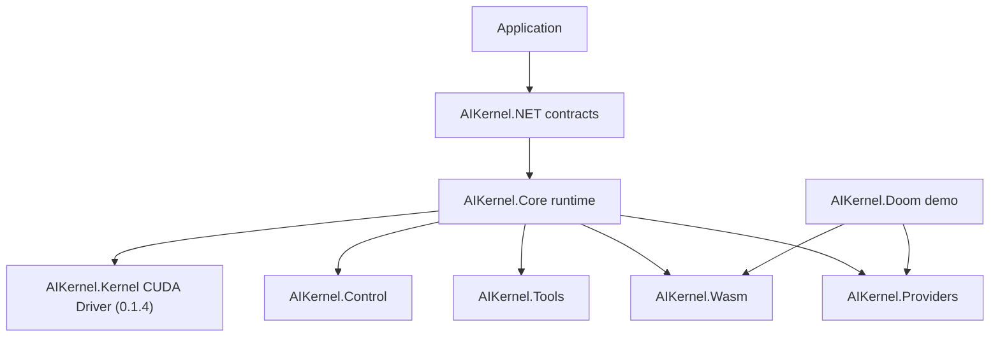

# System Architecture

## 概要

System Architecture は package の責務に焦点を当てます。contracts は定義、Core は実行、Providers は拡張、Control は統治、Tools は検査、Wasm はプロセス状態とホスト呼び出しのモデル化（バイトコードの実行と隔離は組み込み先が担当）、Doom は demo path 検証を担います。

## 背景

生成一覧だけのページは低品質に見えやすいため、このページでは Reference へ進む前に system としての説明を与えます。

## 使い方

機能を contract から runtime package、provider/tool integration、Reference page へ辿ります。Windows x64 と Linux x64 で CUDA を使う場合は、`AIKernel.Kernel` 0.1.4 同梱の CUDA Driver を使います。実行時に必要なネイティブ依存は NVIDIA ドライバのみです。

## 例

## 補足

- Runtime behavior must not be inferred from names alone; check package descriptions and tests.
- Provider and Tool packages are extension surfaces, not contract owners.

## 関連ページ

- [Runtime Model](../runtime/execution-model.md)
- [Provider Model](../providers/provider-model.md)
- [Tools](../tools/tool-model.md)
